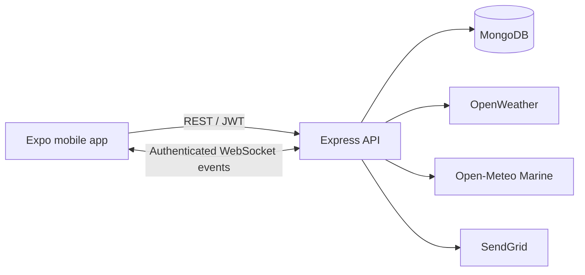

# OceanPulse

OceanPulse is a mobile app for Sri Lankan coastal fishing crews. It brings weather and wave information, direct-distance and fuel estimates, and peer messaging into one place.

This repository contains the mobile app and serves as the main project overview. The backend is maintained separately in [oceanpulse-api](https://github.com/dinukaly/oceanpulse-api).

## What you can do

| Feature | Current behavior |
| --- | --- |
| Accounts | Register, verify an email address, sign in, reset a password, and restore a saved session. |
| Profile | Edit names, contact number, language preference, and boat ID. Failed saves retain the draft; conflicting edits require a reload. |
| Weather | Search by city for temperature, wind speed in m/s, humidity, and cloud cover, with source and retrieval times. |
| Sea conditions | View significant wave-height forecasts for supplied or device coordinates, including following forecast hours and freshness information. |
| Distance and fuel | Select two points on a native map and estimate direct one-way distance and fuel using the boat's measured consumption rate. |
| Messages | Select a user and exchange text messages, with unread counts, Sent/Read receipts, and retry/reconnection handling. |
| SOS records | Confirm a location-bearing request, record it on the server, and check its receipt. |

**An SOS receipt confirms database storage only. OceanPulse does not notify emergency responders or dispatch rescue services.**

Wave heights are forecasts, and route estimates measure direct distance rather than a navigable passage. Fuel estimates exclude the return trip, reserve, and idling. These tools do not provide a fishing-safety verdict.

## Screens and navigation

Signed-in users have five tabs: **Weather, Route, Home, SeaWave, and Profile**. Home provides access to the main tools, SOS records, and the user directory. Messages open as a conversation with a selected peer.

The public flow includes Welcome, sign-in, registration, email verification, and password recovery. Startup validates saved credentials before opening authenticated screens and offers recovery when session verification fails.

Community feed, comment, and text-post components exist, but Community is outside active navigation. A multi-day weather forecast is not connected. These components should not be presented as available destinations.

## Architecture



REST handles durable writes and history retrieval; WebSocket events support messaging updates. The API derives identity from the authenticated account and restricts access to private records. Weather and email credentials remain on the server.

On Android and iOS, access tokens use Expo SecureStore. The web build uses AsyncStorage. Redux manages authentication state; feature hooks handle conditions, messaging, profile drafts, pagination, and SOS recovery.

## Repositories and stack

| Component | Repository | Main technologies |
| --- | --- | --- |
| Mobile app | [oceanpulse-mobile](https://github.com/dinukaly/oceanpulse-mobile) | Expo 52, React Native 0.76, React 18, TypeScript, React Navigation 7, Redux Toolkit, Axios |
| Backend | [oceanpulse-api](https://github.com/dinukaly/oceanpulse-api) | Node.js, Express 5, MongoDB/Mongoose, JWT, WebSockets, SendGrid |

The repositories have independent Git histories and dependency installations. They must use compatible API contracts.

## Run locally

You need Node.js, npm, MongoDB, and an Android or iOS development environment for native features. Web previews are also supported.

### 1. Start the API

Follow the [API setup instructions](https://github.com/dinukaly/oceanpulse-api#readme). Install its dependencies, configure an ignored `.env`, start MongoDB, and run `npm start` in that repository.

The API requires a JWT signing secret. SendGrid credentials and a verified sender enable account verification and password-reset email; an OpenWeather key enables city weather requests. Check `/api/v1/health/ready` for API readiness.

### 2. Configure the mobile app

```sh
git clone https://github.com/dinukaly/oceanpulse-mobile.git
cd oceanpulse-mobile
npm ci
```

Copy `.env.example` to `.env.local`, then set the API root:

```dotenv
EXPO_PUBLIC_API_URL=http://10.0.2.2:3000/api/v1/
```

`10.0.2.2` reaches the host computer from an Android emulator. A physical device needs a server address reachable from that device. Release builds require HTTPS. The URL must end in `/api/v1/` and must not contain credentials, query parameters, or fragments.

`EXPO_PUBLIC_*` values are embedded in the app bundle. Keep secrets in the backend environment, and restart Metro or rebuild after changing the API URL.

### 3. Start the app

```sh
npx expo start --dev-client
```

Use a development build that matches the installed native dependencies. For a local Android build, install the Android SDK and Java, then run:

```sh
npx expo run:android --device --no-bundler
```

Rebuild the development client after native dependency or configuration changes. iOS native builds require macOS/Xcode or a configured remote build service.

For a web preview:

```sh
npm run web
```

The native map is unavailable on web; Route displays a platform explanation. A standalone Android map requires Google Maps key configuration. The web preview cannot validate native location, keyboard, or map behavior.

## Development checks

Run these commands in the mobile repository:

```sh
npm run typecheck
node --test test/*.test.cjs
```

The functional tests cover session handling, conditions, pagination, messaging recovery, profile conflicts, SOS receipt behavior, fuel calculations, and text-post handling. They use controlled platform and transport substitutes where needed.

To check Android JavaScript bundling:

```sh
npx expo export --platform android
```

An export checks bundling; it does not produce an installable APK or establish device acceptance. Cross-repository HTTP/WebSocket/database journeys run from the API repository using its `test:integration` script, with dependencies installed in both checkouts.

## Source layout

```text
App.tsx                         Session/configuration gates and app providers
navigation/                     Public stack, protected stack, and five tabs
components/ui/                  Shared controls, layouts, and status surfaces
components/ui/screen/security/  Authentication and password recovery
components/ui/screen/home/      Conditions, route, profile, SOS, and messaging
constants/                      Theme and API configuration
hooks/                          Shared React hooks
store/                          Redux authentication state
utils/                          API client, feature hooks, contracts, and calculations
test/                           Functional regression tests
assets/                         Fonts, logo, and app images
```
